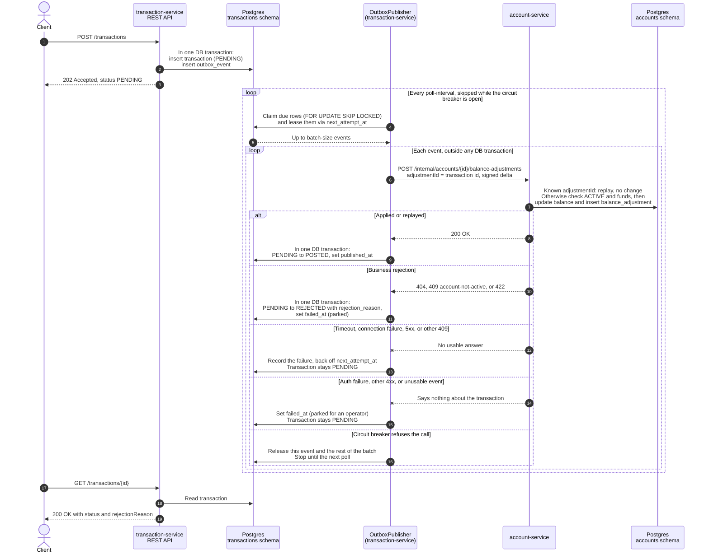

# LedgerWatch — Architecture

## System overview

LedgerWatch is a small personal-finance ledger built as two independent Spring Boot microservices sharing a single Postgres instance (separate schemas, each migrated by Flyway), fronted by a React SPA, with Terraform config in `infra/aws/` that deploys both services to AWS. Both services are stateless JWT resource servers that validate tokens signed with a shared HMAC secret; account-service also issues those tokens.

```
Browser
  └─ React SPA (Vite dev :5173 → proxy → :8081)
       └─ axios /api/*  (Authorization: Bearer <JWT>)

account-service  :8081   ←──── Postgres ledgerwatch DB ────→  transaction-service  :8082
   schema: accounts                                                schema: transactions
   issues + validates JWTs                                         validates JWTs
            └──────────── shared JWT_SECRET (HS256) ────────────────────┘
```

---

## Repository layout

```
LedgerWatch/
├── pom.xml                        # Maven parent (Java 21, Spring Boot 3.3.4)
├── common/                        # Shared library jar (RFC 7807 error handling)
├── account-service/               # Spring Boot — account identity, balances, login
│   ├── Dockerfile                 # Multi-stage build (Maven reactor → JRE 21 Alpine)
│   └── src/main/resources/
│       ├── application.yml        # Default config (port 8081, local Postgres)
│       ├── application-prod.yml   # Prod overrides (all credentials via env vars)
│       └── db/migration/          # Flyway migrations for the `accounts` schema
├── transaction-service/           # Spring Boot — transaction posting & history
│   ├── Dockerfile
│   └── src/main/resources/
│       ├── application.yml        # Default config (port 8082, local Postgres)
│       └── db/migration/          # Flyway migrations for the `transactions` schema
├── frontend/                      # React 19 / TypeScript SPA
├── docker/postgres/init.sql       # Enables pgcrypto only — all DDL is owned by Flyway
├── docker-compose.yml             # Postgres 16 + account-service + transaction-service
├── docs/adr/                      # Architecture decision records
├── .env.example                   # DB_* and JWT_SECRET template
└── infra/aws/                     # Terraform — services on ECS/RDS, SPA on S3 + CloudFront
```

---

## Backend services

### Maven parent (`pom.xml`)

| Property | Value |
|---|---|
| Group ID | `com.ledgerwatch` |
| Version | `0.1.0-SNAPSHOT` |
| Java | 21 |
| Spring Boot BOM | 3.3.4 |
| Testcontainers BOM | 1.21.4 (imported ahead of the Boot BOM — see [ADR-001](docs/adr/0001-testcontainers-for-integration-tests.md)) |
| Modules | `common`, `account-service`, `transaction-service` |

The parent manages the Spring Boot and Testcontainers BOMs, the springdoc version, Spotless (google-java-format), and JaCoCo (70% line-coverage gate). Each service uses `spring-boot-maven-plugin` to produce a fat jar.

---

### common

A plain jar (no Spring Boot plugin) that both services depend on. It holds `AbstractApiExceptionHandler`, the shared RFC 7807 `ProblemDetail` error contract (served as `application/problem+json`), and `InsufficientFundsException`, which both services throw:

| Exception | Status |
|---|---|
| `NoSuchElementException` | 404 |
| `IllegalStateException` | 409 |
| `InsufficientFundsException` | 422, `type: urn:ledgerwatch:problem:insufficient-funds`, `title: Insufficient funds`, with `accountId` and `amount` (the rejected debit) properties |
| `IllegalArgumentException` | 400 |
| `MethodArgumentNotValidException` | 400, with an `errors` map of field → message |

Each service's `GlobalExceptionHandler` is a `@RestControllerAdvice` that extends it; account-service adds a `BadCredentialsException` → 401 handler for login. Both Dockerfiles build through the Maven reactor (`-pl <service> -am`), so `common` is compiled into each image, and CI rebuilds both services when `common/` changes.

#### Logging and correlation IDs

`common` also auto-configures (via `CorrelationIdAutoConfiguration`) request correlation and ships the shared `logback-spring.xml`:

- **Inbound:** `CorrelationIdFilter` runs ahead of Spring Security on every request (including Boot's `/error` dispatch). It takes the caller's `X-Correlation-Id` if it matches `[A-Za-z0-9._:-]{1,128}`, otherwise mints a UUID, puts it in the SLF4J MDC as `correlationId`, and echoes it in the response header.
- **Outbound:** every `RestClient` built from Boot's `RestClient.Builder` gets `CorrelationIdInterceptor`, which forwards the current id as `X-Correlation-Id`.
- **Across the outbox:** delivery runs later on a scheduler thread, so `TransactionService` stores the request's id in `outbox_event.correlation_id` (V6) and `OutboxPublisher` restores it, along with `outboxEventId` and `transactionId`, around each delivery. A `POST /transactions` and the balance adjustment account-service applies for it therefore log under one id. Rows from before V6 get a fresh id per attempt.
- **Format:** `LOG_FORMAT=text` (default; Boot's pattern with a `[correlationId]` slot) or `json` (one logstash-logback-encoder object per line, with `service`, `level`, `logger_name`, `message`, `stack_trace` and all MDC fields at the top level). Both Dockerfiles set `LOG_FORMAT=json`, so Docker Compose and CloudWatch get JSON. Find one request in CloudWatch Logs Insights with `filter correlationId = "<id>"` across both services' log groups.

#### Metrics (transaction-service)

transaction-service registers its own Micrometer meters, all prefixed `ledgerwatch.`:

| Meter | Type | Tags | Meaning |
|---|---|---|---|
| `ledgerwatch.transactions.posted` | Counter | `type` | Transactions settled POSTED |
| `ledgerwatch.transactions.rejected` | Counter | `reason` | Transactions settled REJECTED (`ACCOUNT_NOT_FOUND`, `ACCOUNT_NOT_ACTIVE`, `INSUFFICIENT_FUNDS`) |
| `ledgerwatch.outbox.lag` | Time gauge (s; ms in CloudWatch) | — | Age of the oldest undelivered outbox event; 0 when the outbox is drained |
| `ledgerwatch.outbox.pending` | Gauge | — | Undelivered outbox events |

- **Counters** (`TransactionMetrics`) are incremented by `OutboxPublisher` after the status update commits, and only if `markPosted`/`markRejected` actually moved the row out of PENDING, so a redelivered event isn't counted twice. Every tag value is registered at startup, so idle series report 0 rather than no data.
- **Gauges** (`OutboxBacklogMetrics`) query `outbox_event` each time they're sampled. "Undelivered" means neither published nor parked: events backing off after a transient failure count, parked ones don't. Lag is the signal to alarm on: it climbs steadily while account-service is down or the publisher has stalled, even if only one event is waiting.
- **Export:** with `metrics.cloudwatch.enabled=true`, `CloudWatchMetricsConfig` pushes to CloudWatch every minute (`metrics.cloudwatch.step`) under namespace `LedgerWatch`, with dimension `application=transaction-service`. Boot 3.3 has no CloudWatch auto-configuration, so the registry is declared there. It filters out everything not prefixed `ledgerwatch.`, because CloudWatch bills each name/dimension combination as a custom metric. In CloudWatch, counters appear as `<name>.count` (Sum per minute = transactions settled that minute) and gauges as `<name>.value`. The CloudWatch registry publishes time gauges in its base unit, milliseconds, so `ledgerwatch.outbox.lag.value` is in ms there, and the dashboard divides by 1000. Export is off locally; `GET /actuator/metrics/ledgerwatch.outbox.lag` (ADMIN) shows the same values.

---

### Security (both services)

Both services are stateless OAuth2 resource servers (`spring-boot-starter-oauth2-resource-server`) with near-identical `SecurityConfig` classes:

- **Token validation:** `NimbusJwtDecoder` with an HS256 key built from `jwt.secret` (the `JWT_SECRET` env var, at least 32 bytes). There is no default, so each service fails to start without it.
- **Roles:** the JWT's `roles` claim is mapped to Spring authorities with a `ROLE_` prefix, so `["ADMIN"]` becomes `ROLE_ADMIN`.
- **Sessions/CSRF:** stateless sessions, CSRF disabled.
- **Public paths:** `/actuator/health`, `/v3/api-docs/**`, `/swagger-ui/**`; account-service also permits `POST /auth/login`. Everything else requires a valid token.
- **Method security:** `@EnableMethodSecurity`; write endpoints are guarded with `@PreAuthorize("hasRole('ADMIN')")`.

| Role | Access |
|---|---|
| `ADMIN` | All reads and writes |
| `ANALYST` | Reads only (`GET`); writes return 403 |
| `SERVICE` | Service-to-service `/internal/**` endpoints only. There is no dev user for it; transaction-service mints its own `SERVICE` tokens (see [Calls to account-service](#calls-to-account-service)) |

**Token issuance** lives in account-service. `POST /auth/login` checks credentials against an in-memory dev user store in `AuthService` (BCrypt-hashed) and returns `{ token, tokenType: "Bearer", expiresIn: 3600 }`. Tokens carry `sub`, `roles`, `iat` and `exp` (1 hour). Seeded dev users:

| Username | Password | Roles |
|---|---|---|
| `admin` | `admin123` | `ADMIN` |
| `analyst` | `analyst123` | `ANALYST` |

There is no user database yet; replace the `AuthService` map with a real store when one exists. transaction-service only validates tokens, so both services must share the same `JWT_SECRET`.

---

### account-service

**Port:** `8081`  
**Postgres schema:** `accounts`  
**Migrations:** Flyway (`db/migration`, schema `accounts`); Hibernate `ddl-auto: none`

Key dependencies: `common`, `spring-boot-starter-web`, `spring-boot-starter-data-jpa`, `spring-boot-starter-validation`, `spring-boot-starter-oauth2-resource-server`, `spring-boot-starter-actuator`, `springdoc-openapi-starter-webmvc-ui`, `flyway-core` + `flyway-database-postgresql`, `postgresql` (runtime). Tests use `spring-boot-testcontainers`, Testcontainers `postgresql` and `spring-security-test`.

#### Data model

```sql
accounts.account
  id          UUID PK  DEFAULT gen_random_uuid()
  owner_name  VARCHAR(255) NOT NULL
  status      VARCHAR(20)  NOT NULL DEFAULT 'ACTIVE'   -- ACTIVE | FROZEN | CLOSED
  balance     NUMERIC(19,4) NOT NULL DEFAULT 0
  created_at  TIMESTAMPTZ  NOT NULL DEFAULT now()
  updated_at  TIMESTAMPTZ  NOT NULL DEFAULT now()
  version     BIGINT       NOT NULL DEFAULT 0          -- JPA @Version (optimistic locking, V2)
```

#### REST API

| Method | Path | Auth | Notes |
|---|---|---|---|
| `POST` | `/auth/login` | Public | Exchange `username`/`password` for a JWT |
| `GET` | `/accounts` | Any role | List accounts |
| `GET` | `/accounts/{id}` | Any role | Fetch by UUID |
| `POST` | `/accounts` | `ADMIN` | Create (`ownerName`, optional `initialBalance`) |
| `PATCH` | `/accounts/{id}` | `ADMIN` | Update `ownerName` and/or `status` |
| `POST` | `/internal/accounts/{id}/balance-adjustments` | `SERVICE` | Internal. Apply a signed `delta` (non-zero, ≤4 dp). 422 (insufficient funds) if a negative delta would take the balance below zero; a debit down to exactly 0 is allowed, and credits are never blocked. 409 if the account is `FROZEN`/`CLOSED`. Optimistic-lock conflicts are retried server-side, each attempt in a fresh transaction with jittered exponential backoff (`balance-retry.max-attempts` 10, `initial-backoff` 5ms, `max-backoff` 200ms). 409 only if every attempt conflicts |

#### Configuration

| Profile | Source |
|---|---|
| default | `application.yml`: datasource falls back to `localhost:5432/ledgerwatch` with hard-coded dev credentials; `JWT_SECRET` is required (no fallback) |
| `prod` | `application-prod.yml`: all three datasource values (`DB_URL`, `DB_USERNAME`, `DB_PASSWORD`) **must** be set as environment variables; Hikari pool capped at 5 connections |
| `test` | `application-test.yml`: fixed 32-byte test `jwt.secret`; no datasource (Testcontainers supplies it) |

---

### transaction-service

**Port:** `8082`  
**Postgres schema:** `transactions`  
**Migrations:** Flyway (`db/migration`, schema `transactions`); Hibernate `ddl-auto: validate`

Key dependencies: same as account-service. It validates JWTs but does not issue them to users (no `/auth` endpoint). Tests add WireMock (`wiremock-standalone`).

#### Transaction lifecycle

`POST /transactions` doesn't touch the balance. It records the transaction as `PENDING`, writes its outbox event in the same DB transaction, and returns `202 Accepted`. The outbox publisher then applies the balance change and settles the status, so clients read the outcome with `GET /transactions/{id}`.

```
PENDING ──> POSTED ──> VOIDED     (VOIDED: PATCH by an ADMIN)
   └──────> REJECTED
```

| Publisher outcome | Transaction | Outbox row |
|---|---|---|
| account-service accepts the change | `POSTED` | `published_at` set |
| `404` no such account | `REJECTED`, `ACCOUNT_NOT_FOUND` | parked |
| `409` with type `urn:ledgerwatch:problem:account-not-active` | `REJECTED`, `ACCOUNT_NOT_ACTIVE` | parked |
| `422` insufficient funds | `REJECTED`, `INSUFFICIENT_FUNDS` | parked |
| Any other `409`, such as optimistic-lock retries exhausted in account-service | stays `PENDING` | backoff |
| Timeout, connection failure, `5xx`, circuit breaker | stays `PENDING` | backoff, or released untouched if the breaker refused the call |
| Auth failure, other `4xx`, unusable event | stays `PENDING` | parked; needs an operator |

- **Only business answers reject.** A failure that says nothing about the transaction, such as a bad service token, never produces `REJECTED`. The balance wasn't changed, so the transaction stays `PENDING` until the cause is fixed and the event retried.
- **`REJECTED` and `VOIDED` are terminal.** `PATCH` can change a `description` on `PENDING` or `POSTED` transactions, and its only status change is `POSTED` → `VOIDED`. A `PENDING` transaction can't be voided, because its balance change may already be in flight. Voiding doesn't reverse the balance.
- **Settling is atomic and conditional.** The status and the outbox row change in one local DB transaction, and the update only applies `WHERE status = 'PENDING'`, so a redelivery can't overwrite a later status. `Transaction` uses `@DynamicUpdate`, so a concurrent `PATCH` of the description can't overwrite a settled status.
- **Crash window:** if the publisher dies after account-service applied the change but before the local commit, the lease expires, the event is redelivered, the adjustment replays as a no-op, and the transaction posts.
- **Dashboard:** `/transactions/summary` counts `POSTED` only, so pending and rejected transactions don't appear in it.

#### Posting flow

A transaction posts in two stages: `POST /transactions` records it and returns, then `OutboxPublisher` applies it and settles the status on a later poll. Both Postgres participants are schemas in the same database. The diagram leaves out idempotent replays; see [Idempotent creates](#idempotent-creates).



#### Calls to account-service

`OutboxPublisher` applies each transaction through account-service's `POST /internal/accounts/{id}/balance-adjustments` (CREDIT → `+amount`, DEBIT → `-amount`).

- **Client:** `AccountServiceClient`, a Spring `RestClient` on the JDK `HttpClient` (HTTP/1.1). Configured under `account-service.*`: `base-url` (`ACCOUNT_SERVICE_URL`, default `http://localhost:8081`), `connect-timeout` (default `2s`) and `read-timeout` (default `5s`).
- **Auth:** `ServiceTokenProvider` mints its own HS256 JWT (`sub: transaction-service`, `roles: ["SERVICE"]`, 5-minute TTL, cached and re-minted 60 s before expiry) with the shared `JWT_SECRET`.
- **Telling 409s apart:** account-service reports a FROZEN or CLOSED account as `AccountNotActiveException`, with the problem type `urn:ledgerwatch:problem:account-not-active`. Every other `409` becomes `AccountServiceConflictException`, which is worth retrying later. It doesn't count against the circuit breaker, because account-service is healthy.

#### Transactional outbox

Each created transaction also writes one row to `outbox_event` in the same local DB transaction, so an event exists only if its transaction committed. Idempotent replays write no new event.

- **Event:** `aggregate_type = 'Transaction'`, `aggregate_id` = the transaction id, `event_type = 'TransactionCreated'`. The `payload` (JSONB) holds `transactionId`, `accountId`, `type`, `amount`, `description` and `createdAt`.
- **Delivery:** `OutboxPublisher` polls on a `@Scheduled` fixed delay. Each poll claims up to `batch-size` due rows (`published_at` and `failed_at` null, `next_attempt_at <= now`, oldest first) with `FOR UPDATE SKIP LOCKED` in a short transaction, so concurrent instances split the queue. The claim leases each row by moving `next_attempt_at` forward by `lease`. Rows are then delivered one at a time outside any DB transaction. If an instance dies mid-batch, its leases expire and another poll picks the rows up again.
- **What delivery means:** a `TransactionCreated` event becomes a `POST /internal/accounts/{id}/balance-adjustments` with `adjustmentId` = the transaction id (not the event id). This is the only place a balance is applied. account-service applies each adjustment id at most once, so at-least-once redelivery is safe. account-service also has `POST /internal/events`, which the publisher doesn't use yet.
- **Outcomes:** success sets `published_at`. `AccountServiceUnavailableException` (I/O, timeout or 5xx, after the client's own retries) and `AccountServiceConflictException` increment `attempts`, record `last_error`, and back the row off exponentially: `initial-backoff * 2^(attempts-1)`, capped at `max-backoff`, with no limit on attempts. Any other failure parks the row with `failed_at`. See [Transaction lifecycle](#transaction-lifecycle) for what each outcome does to the transaction.
- **Retrying a parked row:** parked rows are never retried automatically. To retry one whose transaction is still `PENDING`, set `failed_at` back to null. Don't do this for a `REJECTED` transaction: the balance change could apply while the status stays `REJECTED`.
- **Circuit breaker:** the publisher shares the `accountService` breaker with `POST /transactions`. While it is open, polls are skipped. If it trips mid-batch, the rest of the batch is released (`next_attempt_at = now`, `attempts` unchanged).
- **Configuration** (`outbox.publisher.*`): `enabled` (`OUTBOX_PUBLISHER_ENABLED`, default `true`; the `test` profile sets `false` and tests call `publishPending()` directly), `poll-interval` (`OUTBOX_PUBLISHER_POLL_INTERVAL`, default `1s`), `batch-size` (`50`), `lease` (`2m`; keep it longer than a batch's worst-case delivery time, or a slow batch is delivered twice, which is harmless), `initial-backoff` (`1s`), `max-backoff` (`5m`).
- `PATCH` updates don't emit events yet.

#### Idempotent creates

`POST /transactions` accepts an optional `Idempotency-Key` header (1–255 characters; clients typically send a UUID per logical request).

- **Scope:** keys are per caller (the JWT `sub`), enforced by `UNIQUE (caller, idempotency_key)` on `idempotency_record`.
- **Claim first:** the request inserts its key row with `INSERT … ON CONFLICT DO NOTHING` before inserting the transaction, all in one DB transaction. A concurrent duplicate waits on the unique index. If the first request commits, the duplicate replays its response. If it rolls back, the duplicate goes ahead as a new request.
- **Replay:** a repeat with the same key and the same request (a SHA-256 over `accountId`, `type`, the normalized `amount` and `description`) returns the original 202 body, as stored, with an `Idempotent-Replayed: true` header. That body keeps the `PENDING` status from creation time, and later `PATCH`es don't change it either, so read the current status with `GET /transactions/{id}`. No new row or event is inserted.
- **Mismatch:** the same key with a different request returns `422`.
- **Failures aren't recorded:** any error rolls back the claim, so the client can retry with the same key. Keys never expire yet.
- Without the header, every request creates a new transaction, as before.

#### Data model

```sql
transactions.transaction
  id          UUID PK  DEFAULT gen_random_uuid()
  account_id  UUID NOT NULL   -- FK by convention; no DB constraint
  type        VARCHAR(10) NOT NULL        -- CREDIT | DEBIT
  status      VARCHAR(10) NOT NULL DEFAULT 'PENDING'  -- PENDING | POSTED | REJECTED | VOIDED
  rejection_reason VARCHAR(32)                        -- V5: set when REJECTED
  amount      NUMERIC(19,4) NOT NULL
  description VARCHAR(255)
  created_at  TIMESTAMPTZ NOT NULL DEFAULT now()
  updated_at  TIMESTAMPTZ NOT NULL DEFAULT now()

transactions.idempotency_record                       -- V2
  id              UUID PK  DEFAULT gen_random_uuid()
  caller          VARCHAR(255) NOT NULL                -- JWT sub
  idempotency_key VARCHAR(255) NOT NULL
  request_hash    VARCHAR(64)  NOT NULL                -- SHA-256 hex of the request
  transaction_id  UUID FK → transaction(id) ON DELETE CASCADE
  response_body   TEXT                                 -- original 201 body (JSON)
  created_at      TIMESTAMPTZ NOT NULL DEFAULT now()
  UNIQUE (caller, idempotency_key)

transactions.outbox_event                             -- V3
  id             UUID PK  DEFAULT gen_random_uuid()    -- event id; consumers de-dupe on it
  aggregate_type VARCHAR(64) NOT NULL                  -- 'Transaction'
  aggregate_id   UUID NOT NULL                         -- transaction id; no FK
  event_type     VARCHAR(64) NOT NULL                  -- 'TransactionCreated'
  payload        JSONB NOT NULL
  created_at     TIMESTAMPTZ NOT NULL DEFAULT now()
  published_at   TIMESTAMPTZ                           -- NULL until relayed
  attempts       INT NOT NULL DEFAULT 0                -- V4: failed deliveries so far
  next_attempt_at TIMESTAMPTZ NOT NULL DEFAULT now()   -- V4: due time; lease / backoff
  last_error     TEXT                                  -- V4: latest failure, ≤1000 chars
  failed_at      TIMESTAMPTZ                           -- V4: parked; never retried
  correlation_id VARCHAR(128)                          -- V6: id of the request that wrote it
  INDEX (next_attempt_at, created_at) WHERE published_at IS NULL AND failed_at IS NULL
```

#### REST API

| Method | Path | Auth | Notes |
|---|---|---|---|
| `GET` | `/transactions` | Any role | List transactions |
| `GET` | `/transactions/{id}` | Any role | Fetch by UUID |
| `GET` | `/transactions/summary` | Any role | Dashboard summary |
| `POST` | `/transactions` | `ADMIN` | Accept (`accountId`, `type`, `amount` ≤4 dp, optional `description`): `202` with status `PENDING`. The outcome arrives later as `POSTED` or `REJECTED` with a `rejectionReason`; see [Transaction lifecycle](#transaction-lifecycle). Optional `Idempotency-Key` header: replays the original 202, 422 if reused with a different body |
| `PATCH` | `/transactions/{id}` | `ADMIN` | Update `description`, or void a `POSTED` transaction with `status: VOIDED`. 409 for any other status change, or if the transaction is `VOIDED` or `REJECTED` |

---

## Database

A single `ledgerwatch` Postgres 16 database hosts both services under isolated schemas:

- `accounts`: owned and migrated by account-service
- `transactions`: owned and migrated by transaction-service
- `pgcrypto` extension: provides `gen_random_uuid()` for PK generation

### Migrations (Flyway)

Each service owns its schema through Flyway. On startup, Spring Boot's Flyway auto-configuration applies `src/main/resources/db/migration/V*__*.sql` to that service's schema (`spring.flyway.schemas` / `default-schema`) and records history in a per-schema `flyway_schema_history` table, so the two services migrate independently against the same database.

- `V1__baseline.sql` in each service creates the schema, grants it to the `ledger` role, and creates the table shown above. Later migrations: account-service `V2__account_version.sql`; transaction-service `V2__idempotency_record.sql`, `V3__outbox_event.sql`, `V4__outbox_delivery_state.sql`, `V5__transaction_lifecycle.sql`, `V6__outbox_correlation_id.sql`.
- Hibernate never generates DDL. account-service uses `ddl-auto: none`; transaction-service uses `validate` so it fails fast if entities drift from the migrated schema.
- `docker/postgres/init.sql` only enables `pgcrypto`; it no longer creates schemas or tables.
- Schema changes go in a new `V<n>__description.sql` in the owning service. Never edit an applied migration.
- `make migrate` runs `flyway:migrate` for both services through the Flyway Maven plugin against a running Postgres, without booting the apps (override `FLYWAY_URL` / `FLYWAY_USER` / `FLYWAY_PASSWORD`).

### Docker Compose

`docker-compose.yml` runs the full backend:

| Service | Image / build | Port | Notes |
|---|---|---|---|
| `postgres` | `postgres:16-alpine` | `5432` | Named volume `postgres_data`; `init.sql` mounted into `docker-entrypoint-initdb.d`; `pg_isready` healthcheck |
| `account-service` | `account-service/Dockerfile` | `8081` | Waits for `postgres` to be healthy; `DB_URL` points at `postgres:5432` |
| `transaction-service` | `transaction-service/Dockerfile` | `8082` | Same as above; `ACCOUNT_SERVICE_URL` points at `account-service:8081` |

Both services read `JWT_SECRET` from the host environment or `.env` (copy `.env.example`). Flyway migrates each schema when its service starts. The SPA is not containerized; run it with Vite locally (see below). In AWS it's served from S3 through CloudFront (see [Infrastructure](#infrastructure-aws)).

---

## Frontend

**Stack:** React 19 · TypeScript · Vite 8 · Redux Toolkit 2 · React Router 7 · Axios

### Structure

```
frontend/src/
├── api/
│   ├── client.ts       # Axios instance — baseURL /api, 10 s timeout, Bearer token interceptors
│   ├── auth.ts         # POST /auth/login
│   └── accounts.ts     # Typed wrappers around account-service CRUD endpoints
├── auth/
│   ├── auth.ts         # JWT storage (localStorage), payload decode, expiry check
│   └── RequireAuth.tsx # Route guard — redirects to /login when no valid token
├── pages/
│   ├── LoginPage.tsx               # Username/password form → stores JWT
│   ├── AccountsDashboardPage.tsx   # Lists all accounts via RTK thunk
│   ├── AccountDetailPage.tsx       # Single account view + PATCH form
│   └── CreateAccountPage.tsx       # POST /accounts form
├── store/
│   ├── store.ts           # RTK store — single `accounts` slice
│   └── accountsSlice.ts   # Async thunks: fetchAccounts, fetchAccountById, updateAccount
└── types/
    └── account.ts         # Account, UpdateAccountRequest interfaces
```

### Authentication

`LoginPage` calls `POST /api/auth/login` and stores the returned JWT via `auth.setToken`. The Axios request interceptor attaches it as `Authorization: Bearer <token>` on every call. Protected routes are nested under `<RequireAuth />`, which decodes the token client-side and redirects to `/login` if it is missing or past `exp`. The decoded `roles` claim is available through `auth.getUser()`, but the server is the authority: role checks are enforced by `@PreAuthorize`, and 401/403 responses surface as `ApiError`.

### Dev proxy

Vite rewrites `/api/*` → `http://localhost:8081/*` (strips `/api` prefix), so the SPA and account-service share the same origin in development without CORS configuration.

### Testing

Vitest + jsdom + `@testing-library/react`. Test setup in `src/test/setup.ts`.

---

## Infrastructure (AWS)

Terraform config in `infra/aws/` (Terraform ≥ 1.11, AWS provider ~5.0) deploys **account-service, transaction-service and the React SPA**. The root module wires six local modules together, and owns the ECS cluster, Cloud Map namespace and JWT secret that both services share:

| Module | Owns |
|---|---|
| `modules/network` | VPC, internet gateway, public subnets, route table |
| `modules/rds` | Postgres instance, subnet group, security group, DB credentials secret |
| `modules/alb` | Load balancer, its security group, HTTP listener, one target group and path rule per service |
| `modules/frontend` | Private S3 bucket for the SPA build, CloudFront distribution (S3 + ALB origins), origin access control, two CloudFront Functions |
| `modules/monitoring` | CloudWatch dashboard, alarms on each service's 5xx rate, ALB-generated 5xx and outbox lag, and the SNS topic they notify (optional email subscription via `alarm_email`) |
| `modules/ecs-service` | One service: ECR repository, log group, execution role, optional task role (with `metrics_namespace`), security group, Cloud Map record, task definition, ECS service |

The two services are separate `ecs-service` module calls rather than a `for_each`, because they reference each other: account-service allows ingress from transaction-service's security group, and transaction-service reads account-service's internal URL.

### Resources

| Resource | Detail |
|---|---|
| **VPC** | `10.0.0.0/16`, DNS support/hostnames enabled |
| **Subnets** | 2 public subnets across 2 AZs (`10.0.1.0/24`, `10.0.2.0/24`), route to IGW |
| **ECR** | `ledgerwatch/account-service`, `ledgerwatch/transaction-service` — mutable tags |
| **ECS Cluster** | `ledgerwatch-cluster` (Fargate) |
| **ECS Tasks** | Fargate, 0.5 vCPU / 1 GB each, container ports `8081` and `8082`, logs to CloudWatch (`/ecs/ledgerwatch-<service>`, 3-day retention) |
| **ECS Services** | `desired_count = 1` each, public IP assigned directly, registered with the ALB; a 180-second health check grace period covers startup |
| **ALB** | Internet-facing, HTTP on port `80`. `/accounts`, `/accounts/*`, `/auth`, `/auth/*` → account-service; `/transactions*` → transaction-service; anything else → fixed `404`. Target groups use IP targets and check `/actuator/health` every 30 seconds |
| **S3 (frontend)** | `ledgerwatch-frontend-<account-id>`: all public access blocked, SSE-S3, bucket-owner-enforced. The bucket policy lets only this distribution read it (OAC, `AWS:SourceArn` condition) |
| **CloudFront** | One distribution, HTTPS with the default `*.cloudfront.net` certificate, `PriceClass_100`. Default behavior → S3 with `Managed-CachingOptimized`. `/api/*` → ALB over HTTP with `Managed-CachingDisabled` and `Managed-AllViewerExceptHostHeader`, all methods |
| **CloudFront Functions** | `spa-rewrite` (viewer request, default behavior): paths whose last segment has no `.` are rewritten to `/index.html`, so React Router deep links work. `api-strip-prefix` (viewer request, `/api/*`): `/api/accounts` → `/accounts`, mirroring the Vite proxy |
| **Cloud Map** | Private DNS namespace `ledgerwatch.local`; transaction-service calls `http://account-service.ledgerwatch.local:8081` via `ACCOUNT_SERVICE_URL` |
| **RDS** | Postgres 16, `db.t4g.micro`, 20 GB gp3, single-AZ, publicly accessible, no final snapshot |
| **CloudWatch metrics** | transaction-service pushes 7 custom metrics to namespace `LedgerWatch` once a minute. Its task role (`ledgerwatch-transaction-service-task`) may call `cloudwatch:PutMetricData` only with that namespace (a `cloudwatch:namespace` condition, since the action has no resource-level permissions) |
| **CloudWatch alarms** | `ledgerwatch-<service>-5xx-rate`: target 5xx ÷ `RequestCount` per target group, a metric-math `IF` that reads 0 below 10 requests in the 5-minute window. `ledgerwatch-alb-5xx`: a count of `HTTPCode_ELB_5XX_Count`, since requests rejected before a target is chosen aren't in `RequestCount`. `ledgerwatch-outbox-lag`: Maximum of `ledgerwatch.outbox.lag.value` > 300 000 ms for 3 of 3 minutes; missing data stays missing, so a paused service doesn't look healthy or broken. All notify the `ledgerwatch-alarms` SNS topic on ALARM and OK |
| **Secrets Manager** | `ledgerwatch/db` stores `url`, `username`, `password` JSON; `ledgerwatch/jwt` stores the shared HMAC key. Each service's task execution role reads them at startup |
| **Security groups** | One per service: all egress open; ingress on the container port from the ALB, plus the optional `admin_cidr` variable. account-service also allows `8081` from transaction-service. RDS: inbound `5432` from both service SGs (and optional `admin_cidr`) |

### Notable design choices

- **No NAT Gateway** — cost-minimized; ECS tasks get public IPs directly, though only the ALB, sibling services and `admin_cidr` can reach them.
- **ALB default action is a `404`** — routes are an allowlist, so `/internal/*`, `/actuator/*` and Swagger stay off the public endpoint.
- **HTTPS at the edge, HTTP to the ALB.** Browsers reach CloudFront over HTTPS, but the CloudFront → ALB hop and direct ALB access are plain HTTP because there's no domain or ACM certificate yet. Credentials and JWTs therefore still cross the internet unencrypted between AWS edge locations and the ALB. Add an HTTPS listener (and restrict the ALB security group to the `com.amazonaws.global.cloudfront.origin-facing` prefix list) before putting real data behind this.
- **SPA fallback via a CloudFront Function, not `custom_error_response`.** Custom error responses apply to the whole distribution, so a 403→`/index.html` mapping would also replace the API's 401/403/404 `problem+json` bodies with HTML. Rewriting only extensionless paths on the S3 behavior leaves API errors alone. The bucket policy also grants `s3:ListBucket`, so a missing asset returns a real 404 instead of an S3 403.
- **Same-origin API.** Serving the SPA and `/api/*` from one CloudFront hostname keeps the `baseURL: '/api'` client unchanged between dev and prod, and needs no CORS config on the services. `Authorization` can't be listed alone in an origin request policy; with caching disabled, the all-viewer-headers policy is what carries it to the ALB on GETs (the README deploy steps check this).
- **RDS is publicly accessible** with a randomly generated 24-char password; access is locked to the service security groups (and optionally a one-time admin CIDR for schema seeding).
- `backup_retention_period = 0` and `skip_final_snapshot = true` — this deployment is torn down after smoke-test verification.
- DB credentials are injected into the container as secrets using the ECS `secrets` field (resolves individual JSON keys from the Secrets Manager ARN at task startup).

### Terraform state

State is stored in S3 at `ledgerwatch/terraform.tfstate`, with S3 native locking (`use_lockfile`) rather than a DynamoDB table. The bucket, `ledgerwatch-tfstate-<account-id>`, is created by a separate config in `infra/aws/bootstrap/`, which keeps its own state locally because it can't store state in a bucket that doesn't exist yet. That config is deliberately outside the root module, so `terraform destroy` leaves the state bucket alone.

State contains the DB password and JWT key in plaintext, so the bucket blocks public access, encrypts with SSE-S3, denies non-TLS requests and sets `prevent_destroy`. Versioning keeps superseded state for 90 days as the recovery path. The backend block is a partial config: the bucket name is passed at `terraform init` so the account ID stays out of the repo. Bootstrap steps are in the README.

### CI access to AWS (GitHub OIDC)

GitHub Actions authenticates to AWS with short-lived credentials from GitHub's OIDC token, so no AWS access keys are stored as repo secrets. `infra/aws/bootstrap/github-oidc.tf` creates the account's `token.actions.githubusercontent.com` identity provider and the `ledgerwatch-github-deploy` role. Like the state bucket, these live in the bootstrap config because CI needs them before it can run anything, and destroying the app stack must not remove them.

The role's trust policy requires `aud = sts.amazonaws.com` and an exact `sub` match (`StringEquals`, no wildcards) on `repo:brandonmoeri/LedgerWatch:ref:refs/heads/<branch>` for each branch in `github_deploy_branches` (default `master`, `dev`). Pull-request runs (`sub` ends in `:pull_request`), other branches, tags and other repos can't assume it. A workflow needs `permissions: id-token: write` and `aws-actions/configure-aws-credentials` with `role-to-assume: ${{ vars.AWS_DEPLOY_ROLE_ARN }}`. `.github/workflows/aws-oidc-check.yml` is a manual smoke test that runs `aws sts get-caller-identity`.

The role's permissions cover the README's manual deploy steps, apart from Terraform itself: push to the `ledgerwatch/*` ECR repos, `UpdateService`/`DescribeServices` on the `ledgerwatch-*` services in `ledgerwatch-cluster`, write to the frontend bucket, and create CloudFront invalidations. Running `terraform apply` from CI would need much broader IAM rights and isn't granted.

### Terraform outputs

`alb_url`, `frontend_url`, `frontend_bucket`, `frontend_distribution_id`, `ecr_repository_urls` and `ecs_service_names` (maps keyed by service), `rds_endpoint`, `rds_port`, `ecs_cluster_name`, `db_secret_arn`, `db_password` (sensitive).

---

## Local development

```bash
# 0. Configure secrets (JWT_SECRET is required by both services)
cp .env.example .env

# 1a. Run Postgres + both services in Docker (Flyway migrates on startup)
make up                                          # docker compose up -d --build

# 1b. …or run Postgres in Docker and the services from Maven
docker compose up -d postgres
export JWT_SECRET=...                            # same value for both services
mvn -pl account-service -am spring-boot:run      # http://localhost:8081
mvn -pl transaction-service -am spring-boot:run  # http://localhost:8082

# 2. Start the SPA (proxied to account-service); log in as admin/admin123 or analyst/analyst123
cd frontend && npm install && npm run dev        # http://localhost:5173
```

Swagger UI is served at `/swagger-ui.html` on each service. Call `POST /auth/login` on account-service to get a token for the "Authorize" button.

## Testing

```bash
# Backend unit + integration tests (requires Docker; no running Postgres needed)
mvn test

# Frontend
cd frontend && npm test

# Both
make test
```

Backend integration tests run against real Postgres via **Testcontainers** ([ADR-001](docs/adr/0001-testcontainers-for-integration-tests.md)). Each service has a `TestcontainersConfiguration` that declares a `postgres:16-alpine` `PostgreSQLContainer` bean annotated `@ServiceConnection`. `@SpringBootTest` classes `@Import` it, and Spring Boot points the datasource at the container automatically. Flyway runs the real migrations against it, so tests exercise the production schema. The container uses database `ledgerwatch` and user `ledger` to match the `GRANT … TO ledger` in the baseline migrations. New integration tests should import the existing configuration rather than hardcode a datasource.

Security coverage per service:

- `JwtSecurityIntegrationTest`: requests with no token, a token signed with the wrong secret, or a tampered signature get 401; a validly signed token gets 200; `/actuator/health` is reachable without a token.
- `RoleAuthorizationIntegrationTest`: `ANALYST` gets 403 on writes; `ADMIN` succeeds.

CI runs on GitHub-hosted `ubuntu-latest` runners, which have Docker preinstalled, so no `services:` Postgres block is needed. JaCoCo enforces a 70% line-coverage minimum.
